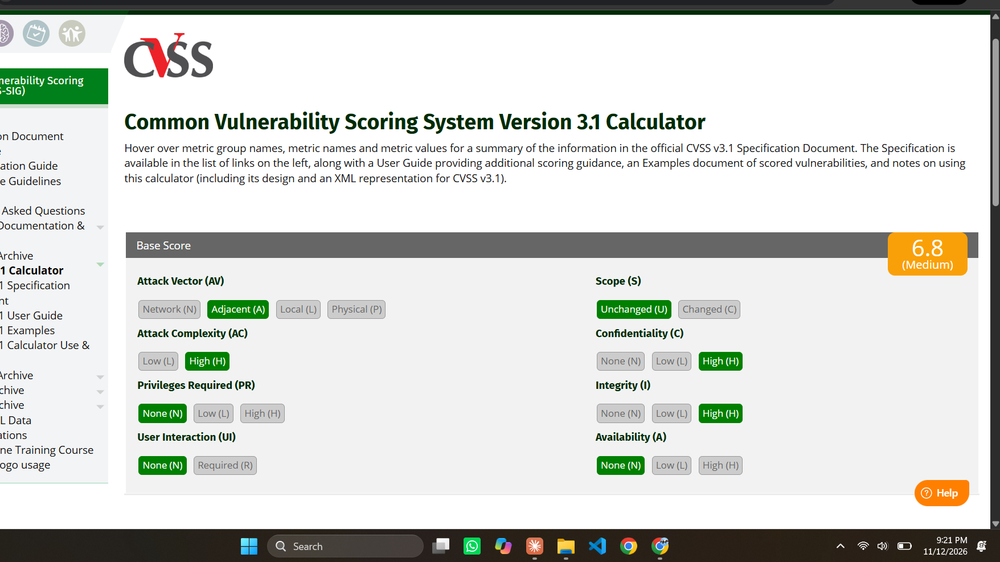
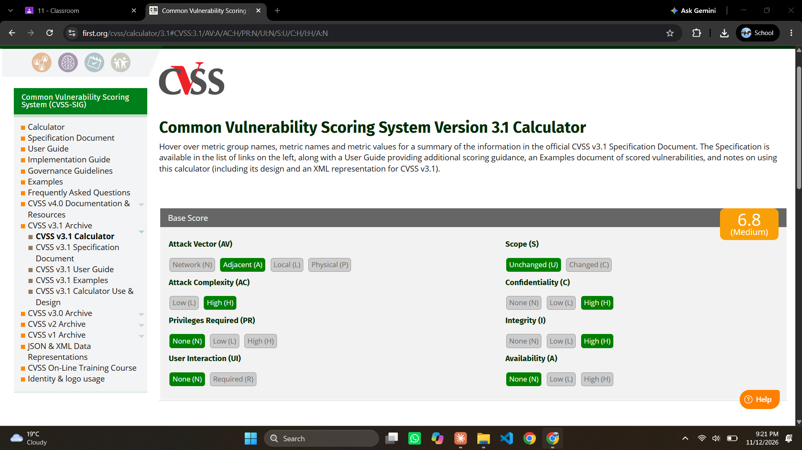
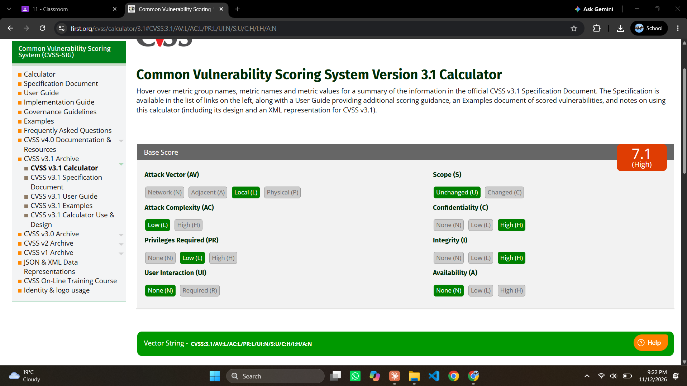
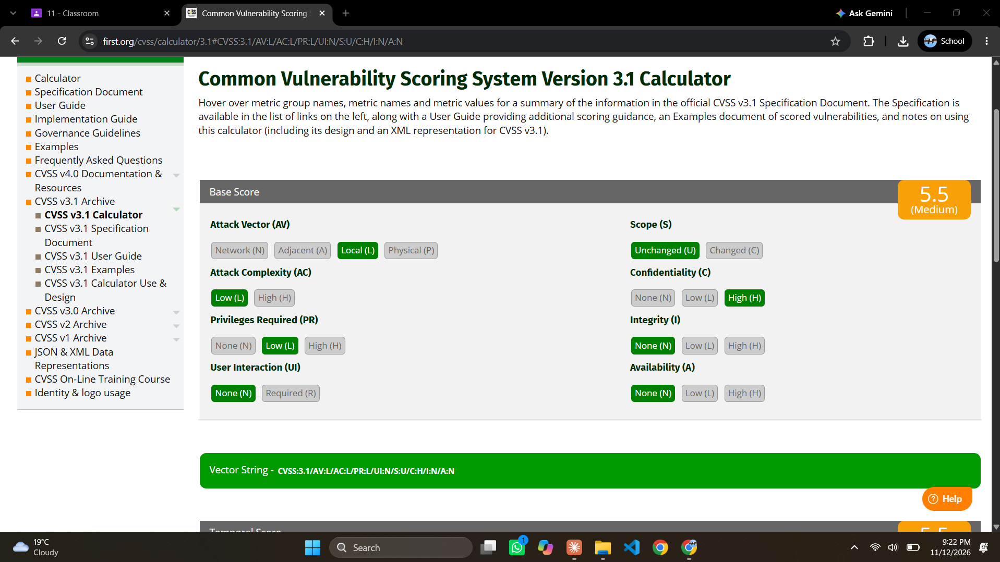
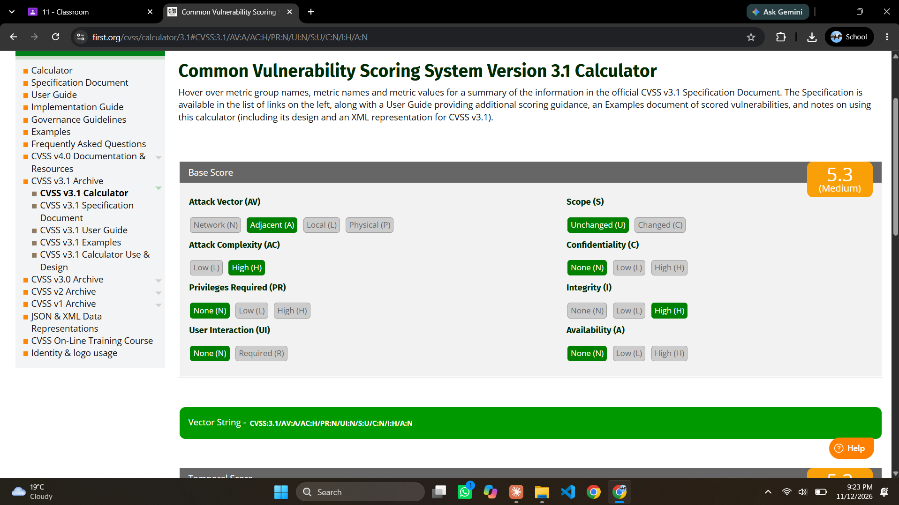
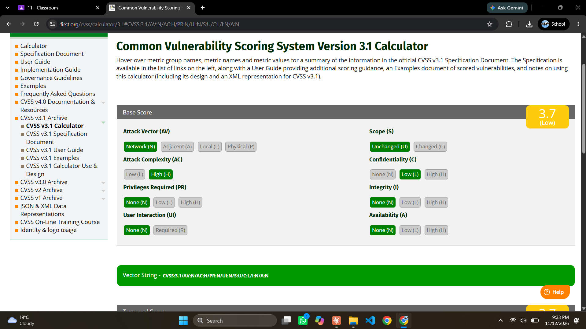
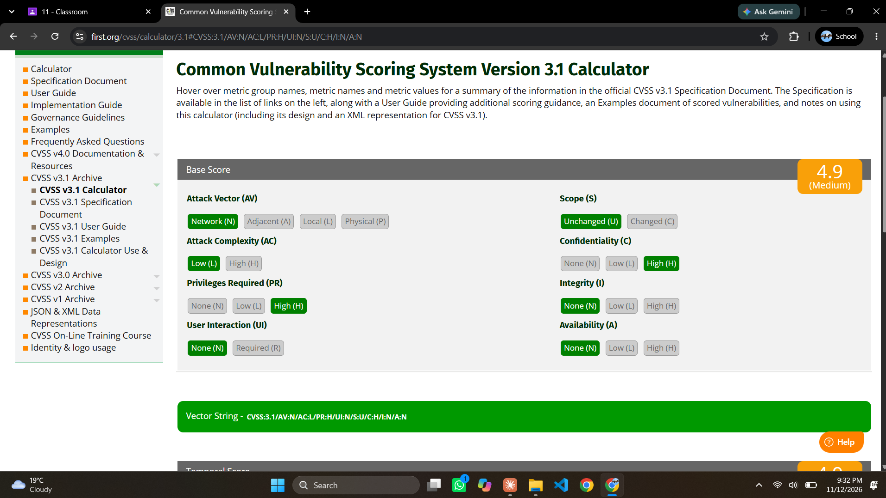

# Phase B — Threat & Vulnerability Assessment

**Project:** Secure Chat System — Design, Threat Analysis, Attack Simulation & Hardening
**Course:** CY2004 Cyber Security (BS-CY)
**CLO mapped:** CLO1 — Explain common threats and vulnerabilities in computer systems, including their sources, types, and potential impacts.
**Scope analyzed:** the Phase A baseline build (`server.py`, `client.py`, `client_ui.py`, `crypto.py`, `authentication.py`, `config.py`, `credentials.txt`).
**Methods used:** attack-surface enumeration (Nmap), vulnerability assessment and scoring (CWE / OWASP Top 10 / CVSS), attack-stage modeling (Cyber Kill Chain / MITRE ATT&CK), threat-actor profiling.

---

## 1. Introduction

The Phase A baseline implements a working client–server chat system using Diffie–Hellman key exchange, AES-256-CBC encryption, and salted SHA-256 password hashing. This baseline was built to be functionally correct but was deliberately left with the realistic weaknesses that a security analyst is expected to find in a first-pass implementation. This report enumerates the system's attack surface, identifies its vulnerabilities, classifies and scores each one, profiles the threat actors most likely to target it, and maps the two most significant attack paths to the Cyber Kill Chain and MITRE ATT&CK.

## 2. Attack-Surface Enumeration

The system exposes two network services and one sensitive local file:

| Item | Detail |
|---|---|
| **8080/tcp** | The chat server (`server.py`). Binds to all interfaces (`bind(("", 8080))`), so it is reachable from any host on the network, not just localhost. |
| **8000/tcp** | The web bridge (`client_ui.py`), bound to `127.0.0.1` by default. Only open while `client_ui.py` is running. |
| **`credentials.txt`** | Local file holding every registered username with its salt and password hash. |
| **Network path** | All client–server traffic travels over the LAN in the clear at the transport layer (TCP), protected only by the application-level AES encryption. It is exposed to ARP spoofing on a shared network segment. |

This was confirmed experimentally with Nmap from the attacker machine (Kali) against the host running the project.

**Scan 1 — initial state** (`nmap -sV -p 8080,8000 127.0.0.1`): with only `server.py` running, port 8080 was open (misidentified by Nmap as `http-proxy?`, since it is a custom base64-framed protocol rather than real HTTP) and port 8000 was closed, confirming the web bridge was not active.

**Scan 2 — with the web bridge running** (`nmap -sV --version-intensity 9 -p 8080,8000 127.0.0.1`): once `client_ui.py` was started, port 8000 opened and a deep version scan returned the complete login-page HTML, HTTP response headers, and a `Server: SecureChatUI/1.0 Python/3.14.8` banner. This is itself a finding (see V11 below).

**Scan 3 — aggressive scan** (`nmap -sV -A -p 8080,8000 127.0.0.1`): repeats the banner/HTML disclosure with additional fingerprinting detail.

**Scan 4 — scan summary**: OS-guess results and scan completion for the same aggressive scan.

## 3. Vulnerability Assessment

Each vulnerability below is classified by CWE, mapped to the OWASP Top 10 (2021) where applicable, scored with CVSS v3.1, and rated for its CIA impact. CVSS vectors were calculated manually and cross-checked against the NVD/FIRST calculator.

| # | Vulnerability | Where | CWE | OWASP 2021 | CVSS v3.1 | CIA | ATT&CK |
|---|---|---|---|---|---|---|---|
| V1 | Unauthenticated DH key exchange, so a man-in-the-middle can substitute keys | `crypto.py`, `server.py`, `client.py` | CWE-322 | A02 | 6.8 Medium (`AV:A/AC:H/PR:N/UI:N/S:U/C:H/I:H/A:N`) | C, I | T1557 (T1557.002 ARP spoofing) |
| V2 | Credential file stored unprotected on disk, with no OS-level access control, and historically tracked in git | `credentials.txt` | CWE-732 | A01, A05 | 7.1 High (`AV:L/AC:L/PR:L/UI:N/S:U/C:H/I:H/A:N`) | C, I | T1552.001 |
| V3 | Fast salted SHA-256 used for password hashing, so offline cracking is cheap | `authentication.py` | CWE-916 | A02 | 5.5 Medium (`AV:L/AC:L/PR:L/UI:N/S:U/C:H/I:N/A:N`) | C | T1110.002 |
| V4 | AES-CBC with no message authentication code, so ciphertext can be modified in transit without detection | `crypto.py` | CWE-353 | A02 | 5.3 Medium (`AV:A/AC:H/PR:N/UI:N/S:U/C:N/I:H/A:N`) | I | T1565.002 |
| V5 | Plain SHA-256 of the DH shared secret used as the key-derivation step, instead of a dedicated KDF such as HKDF | `crypto.py` | CWE-327 | A02 | 3.7 Low (`AV:N/AC:H/PR:N/UI:N/S:U/C:L/I:N/A:N`) | C | T1600 |
| V6 | No brute-force protection or account lockout on login attempts | `server.py`, `authentication.py` | CWE-307 | A07 | 6.5 Medium (`AV:N/AC:L/PR:N/UI:N/S:U/C:L/I:L/A:N`) | C, I | T1110.001, T1110.003 |
| V7 | No limit on concurrent connections or threads, and no timeouts (`listen(5)` backlog, one thread spawned per connection) | `server.py` | CWE-770 | A04 | 7.5 High (`AV:N/AC:L/PR:N/UI:N/S:U/C:N/I:N/A:H`) | A | T1499.002 |
| V8 | The server decrypts and can read every chat message in order to forward it; there is no end-to-end encryption | `server.py` | CWE-311 | A04 | 4.9 Medium (`AV:N/AC:L/PR:H/UI:N/S:U/C:H/I:N/A:N`) | C | T1005 |
| V9 | Username enumeration via distinct registration responses and the visible user list | `authentication.py`, `server.py` | CWE-204 | A07 | 5.3 Medium (`AV:N/AC:L/PR:N/UI:N/S:U/C:L/I:N/A:N`) | C | T1087 |
| V10 | No sequence numbers or nonces on messages, so captured ciphertext can be replayed | `server.py`, `crypto.py` | CWE-294 | A02 | 3.1 Low (`AV:A/AC:H/PR:N/UI:N/S:U/C:N/I:L/A:N`) | I | T1557 |
| V11 | Verbose server banner discloses exact software and version (`Server: SecureChatUI/1.0 Python/3.14.8`), and error responses leak internal implementation detail (JSON error bodies, generated HTML error pages) — confirmed directly in the Nmap evidence above | `client_ui.py` | CWE-200 | A05 | 5.3 Medium (`AV:N/AC:L/PR:N/UI:N/S:U/C:L/I:N/A:N`) | C | T1592.002 |

These findings match the vulnerabilities the project brief identifies as expected for this baseline: unauthenticated key exchange, fast password hashing, missing message integrity, weak key derivation, and an unprotected credential file.

### 3.1 CVSS Verification Evidence

Each vector in the table above was entered into the official FIRST CVSS v3.1 calculator, and the score it returned matches the table. V9 and V11 share the same vector, so one screenshot covers both. A first manual estimate for V4 gave 4.5; the calculator returned 5.3, so the table uses the calculator's value.

| Vuln | Calculator score |
|---|---|
| V1 | 6.8 Medium |
| V2 | 7.1 High |
| V3 | 5.5 Medium |
| V4 | 5.3 Medium |
| V5 | 3.7 Low |
| V6 | 6.5 Medium |
| V7 | 7.5 High |
| V8 | 4.9 Medium |
| V9, V11 | 5.3 Medium |
| V10 | 3.1 Low |

**V1**

**V2**

**V3**

**V4**

**V5**

**V6**

**V7**

**V8**

**V9 and V11**

**V10**

### 3.2 CWE Verification

All 11 CWE-IDs in the table above were independently confirmed against the official MITRE CWE database (`cwe.mitre.org/data/definitions/<id>.html`). Each page's title and description were checked against the vulnerability it is assigned to; all matched.

| Vuln | CWE | Confirmed title |
|---|---|---|
| V1 | CWE-322 | Key Exchange without Entity Authentication |
| V2 | CWE-732 | Incorrect Permission Assignment for Critical Resource |
| V3 | CWE-916 | Use of Password Hash With Insufficient Computational Effort |
| V4 | CWE-353 | Missing Support for Integrity Check |
| V5 | CWE-327 | Use of a Broken or Risky Cryptographic Algorithm |
| V6 | CWE-307 | Improper Restriction of Excessive Authentication Attempts |
| V7 | CWE-770 | Allocation of Resources Without Limits or Throttling |
| V8 | CWE-311 | Missing Encryption of Sensitive Data |
| V9 | CWE-204 | Observable Response Discrepancy |
| V10 | CWE-294 | Authentication Bypass by Capture-replay |
| V11 | CWE-200 | Exposure of Sensitive Information to an Unauthorized Actor |

## 4. Threat-Actor Profiling

| Actor | Motive | Capability | Relevant vulnerabilities |
|---|---|---|---|
| Malicious insider / server administrator | Read private messages, steal the credential file for use elsewhere | High — already has access to the server host and its files | V2, V3, V8 |
| LAN attacker (opportunistic / script kiddie) | Eavesdrop on or tamper with chat traffic for curiosity or minor disruption | Medium — needs only to be on the same network segment with common tools (ARP spoofing, Wireshark) | V1, V4, V10 |
| Cybercriminal | Steal credentials for reuse (password reuse across services), account takeover | Medium–high — motivated, may automate login attempts and offline cracking | V3, V6, V9 |
| Disruptor / hacktivist | Deny service to embarrass the operator or make a point | Low–medium — a simple connection-flood script is enough given V7 | V7 |

## 5. Attack-Stage Mapping (Cyber Kill Chain / MITRE ATT&CK)

The two most significant attack paths are mapped below.

| Attack | Reconnaissance | Weaponization | Delivery | Exploitation | Installation | C2 | Actions on Objectives |
|---|---|---|---|---|---|---|---|
| **MITM on key exchange** (V1) | Nmap scan of the network to find the chat server (as evidenced above); ARP scan to find client/server hosts | ARP-spoofing tool configured to target both endpoints | Spoofed ARP replies poison both hosts' ARP tables | Attacker inserts itself as "man in the middle" during the unauthenticated DH exchange, establishing separate shared keys with each side | n/a (no persistence needed — attack holds only while ARP poisoning is maintained) | n/a | Read and/or alter chat messages in both directions in real time |
| **Offline credential cracking** (V2, V3) | Locate `credentials.txt` via insider access or an unprotected backup/export | Hashcat or John the Ripper configured for salted SHA-256 (`sha256($salt.$pass)`) | Attacker obtains a copy of the file | Cracks weak/common passwords offline, unconstrained by online rate limits | n/a | n/a | Log in as the victim; access their conversations and identity |

A third, lower-effort attack worth noting from the Nmap evidence: **reconnaissance via banner grabbing** (V11) — an attacker scanning the network can fingerprint the exact software and version running on port 8000 directly from the Nmap output, which shortens the reconnaissance stage for any follow-on attack.

## 6. Conclusion

The Phase A baseline is functionally sound but carries the vulnerabilities that are typical of a first implementation built for correctness rather than resilience: an unauthenticated key exchange, encryption without integrity protection, fast password hashing, basic key derivation, an unprotected credential store, and no limits on connection volume or login attempts. The attack-surface scan confirms two reachable network services, one of which additionally leaks implementation detail through verbose banners. These findings form the baseline against which Phase D's simulated attacks (MITM via ARP spoofing, offline password cracking) and subsequent hardening will be measured.

## 7. Scope Not Covered in This Phase

- The browser-side JavaScript (`UI/app.js`) has not been separately source-reviewed for client-side issues (e.g. DOM-based XSS); only the server-side web bridge (`client_ui.py`) was scanned at the network level.
- CVSS vectors and CWE-IDs were both independently verified, respectively against the FIRST calculator and the MITRE CWE database, as part of this submission (Sections 3.1 and 3.2).

## Appendix — Evidence Index

| File | Command | What it shows |
|---|---|---|
| `ScreenShots/Screenshot 2026-11-12 072433.png` | `nmap -sV -p 8080,8000 127.0.0.1` | 8080 open, 8000 closed (web bridge not yet running) |
| `ScreenShots/Screenshot 2026-11-12 073538.png` | `nmap -sV --version-intensity 9 -p 8080,8000 127.0.0.1` | Both ports open; full banner/HTML leak on 8000 |
| `ScreenShots/Screenshot 2026-11-12 073759.png` | `nmap -sV -A -p 8080,8000 127.0.0.1` | Banner and fingerprint detail |
| `ScreenShots/Screenshot 2026-11-12 073818.png` | Same scan as above | OS-guess summary and scan completion |
